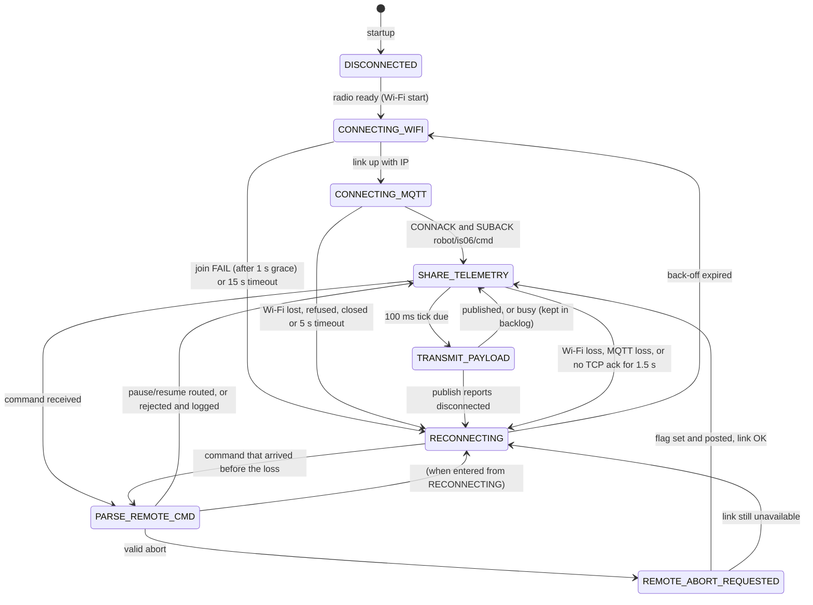
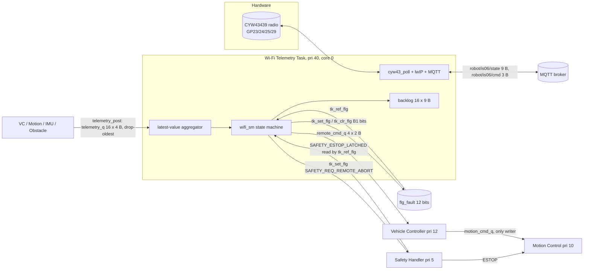

# Buddy 1 — Wi-Fi Communication, Command and Telemetry (IS-06)

Owner: Lai Jia Bao (2500915). Platform: Raspberry Pi Pico W (CYW43439 on-board radio) on the Robo Pico, C, Pico C SDK 2.2.0 drivers, μT-Kernel 3.0 (dual-core port).

This document replaces the Week 6 / Tribunal 1 Buddy 1 artefacts where they disagree. Section 0 lists what was wrong and what changed.

**Status labels used below**

| Label | Meaning |
|---|---|
| **IT-host** | Implemented; tested by the PC unit tests (logic only — fake network, kernel and clock). Evidence: `testing/subsystem1/logs/2026-10-29_host_unit.txt` |
| **IB** | Implemented; builds and links for the Pico W in every profile; **not yet run on hardware** |
| **IN** | Implemented but not yet tested (on-target test written, not run) |
| **P** | Proposed (agreed interface, not implemented by its owner yet) |
| **D** | Deferred |
| **B** | Blocked (needs code or hardware that does not exist yet) |

Mapping to the brief's labels: **IT-host** = implemented and tested (PC logic tests only); **IB** and **IN** = implemented but not yet tested on target; **P** = proposed; **D** = deferred; **B** = blocked.

Hardware runs exist for the shared image and are recorded in
`testing/subsystem1/TEST_LOG.md` and `testing/subsystem2/TEST_LOG.md`.
Any item without captured console or broker output remains **unverified**;
host-only evidence is not hardware evidence.

---

## 0. Repository findings and corrected contradictions

What the repository contained before this change (commit `2eb0a68`): the course template only. `app_program/subsystem1` was the LED example; there was no Buddy 1 code, no `telemetry_q`, `remote_cmd_q`, fault flags, statechart code or `app_data.h`. The only network code was the kernel's `cyw43_utk_task` plus a heartbeat demo in `lib/liblwip/sysdepend/pico_rp2040/mqtt_utk.c`.

| # | Contradiction / defect found | Resolution | Status |
|---|---|---|---|
| C1 | Design says "Wi-Fi Telemetry Task, priority 40, lowest". The real radio/lwIP/MQTT work ran in the kernel's `cyw43_utk_task` at **priority 4 — above Safety (5)**. A priority-40 application task could not have helped: lwIP is `NO_SYS=1`, so only that one task may call cyw43/lwIP/MQTT (TEAM.md §3). | The stack-owning task **is** the Wi-Fi Telemetry Task: its priority is now 40 (`cyw43_utk_kernel.c`), and Buddy 1's logic runs inside it through the `wifi_app_poll()` hook, called once per poll iteration. One task, one owner, lowest priority. | IB |
| C2 | `CNF_MAX_TSKPRI` was 32, so `tk_cre_tsk(pri = 40)` returns `E_PAR`. | Raised to 48 (`config/config.h`); the kernel's >32 ready-queue path needs `knl_bitset/bitclr/bitsearch1`, enabled in `config/config_func.h`. A compile-time `#error` guards the pair. | IB |
| C3 | Week 6 MQTT table: JSON payloads (~110 B). Tribunal 1: "9-byte little-endian frame". Both were live. | **Binary only.** JSON is not implemented, not even as a debug mode; the PC tool `tools/wifi_telemetry_tool.py` decodes frames to readable text instead. | IT-host |
| C4 | The 9-byte frame was asserted, never allocated. | Allocation table in §7: 66 bits used + 6 reserved = 72 bits = 9 bytes, proven by `_Static_assert` in `app_data.h`. | IT-host |
| C5 | `telemetry_q` "drop-oldest" with many producers had no mechanism; producers cannot remove a queue head under a lock without delaying control tasks. | μT-Kernel message buffer; a producer that finds it full receives (drops) the oldest message itself and retries once, both `TMO_POL`. Two atomic kernel calls, no application lock (§9). | IT-host + IN |
| C6 | Shared fault mask: Tribunal agreed event flags, but no bit list, owner or clear rule existed. | `flg_fault`, 12 bits, one owner per bit, `tk_set_flg`/`tk_clr_flg` only (§10). ESTOP latch has a single source (`flg_safety`), only mirrored into telemetry. | IT-host + IN |
| C7 | Statechart said "REMOTE_ABORT_REQUESTED returns to SHARE_TELEMETRY when the **system reset** completes" — that would hold the Wi-Fi task until Safety resets, i.e. a dead end while ESTOP is latched. | Abort handling completes as soon as the Safety flag is set and the request posted; then SHARE_TELEMETRY (link OK) or RECONNECTING (link down). ESTOP recovery stays with Safety. | IT-host |
| C8 | "keep-alive miss detected within 2 s": lwIP's MQTT keep-alive works in whole seconds on a 5 s cyclic timer (`MQTT_CYCLIC_TIMER_INTERVAL`), so it cannot detect a loss in 2 s. | Liveness from TCP progress: every QoS 0 publish completes when TCP acks it (`mqtt_tcp_sent_cb`). No ack for 1.5 s while publishes are outstanding → `FLT_SOCK_TIMEOUT` → RECONNECTING. | IT-host (simulated worst 1.60 s) |
| C9 | Two reconnect policies: `cyw43_utk.c` rejoined every 5 s and `mqtt_utk.c` retried every 3 s on their own. | With `MQTT=1` both are disabled; the state machine owns reconnection with bounded back-off 0.5/1/2/4 s. | IT-host |
| C10 | Abort flow listed "post to remote_cmd_q, then set the Safety flag". With that order the Vehicle Controller (12) can preempt and act before Safety (5) latches. | **Safety flag first**, then `remote_cmd_q` (both non-blocking, microseconds apart). Safety latches ESTOP before the VC sees the request, matching the rest of the flow (Safety → Motion → VC). Buddy 1 will keep this fail-safe ordering. | IT-host; team decision recorded 2026-11-01 |
| C11 | "Malformed or a repeated seq is ignored" left resume replay open: a retained/replayed `resume` would be the first command after reboot. | `resume` needs a sequence baseline and a newer sequence; abort/pause are accepted even out of window (fail-safe direction). | IT-host |
| C12 | Wi-Fi task table row said "wakes on telemetry_q" **and** "100 ms cyclic". | Polls every iteration of the service loop (~10 ms on the 10 ms tick), drains `telemetry_q` with `TMO_POL`, publishes on a 100 ms schedule. It never waits on a kernel object. | Hardware evidence: S1-U06/S1-U24 in the 2026-11-01 run-4 capture; S1-U25 still unverified |
| C13 | Found in the 2026-10-29 validation review: the TCP-liveness age was computed as `now − last_progress` in unsigned arithmetic. `now` is sampled once at the start of `wifi_app_poll()`, but `mqtt_utk_publish()` stamps `last_progress_ms` with its own `sys_now()` later in the same poll. A 10 ms tick (or a preemption by any higher-priority task) in between makes `last_progress > now`, the subtraction wraps to ≈ 4.29 × 10⁹ ms, and the same poll reported a false `FLT_SOCK_TIMEOUT` and reconnected. On hardware this would have caused random reconnects while the link was healthy. | `progress_age()` in `wifi_sm.c` takes the signed difference and treats a negative age as 0, for both the liveness check and the reported detection time. Regression test S1-H52 fails on the old code and passes on the new code. | IT-host |

Other things worth knowing:

* `remote_cmd_q`, `flg_safety` and `flg_fault` belong to the Vehicle Controller and the Safety Handler, whose code does not exist yet. They are created in `app_program/app_shared.c` as an **interim owner** so Buddy 1 can be built and tested; the owners move them (same names and formats) when their code lands. **P**
* The template LED example stays in `subsystem1/` because the subsystem 4 example (IF-05) suspends it. It runs at priority 12, which equals the planned Vehicle Controller priority; remove it before integration. **Risk R8**
* The kernel tick is 10 ms (`CNF_TIMER_PERIOD`). `tk_dly_tsk(2)` in the radio loop therefore sleeps one tick, not 2 ms.
* On the first normal-replug run, `TIMERAWL` was about 43x slow (`tk_dly_tsk(10)` = 468 us). The shared-kernel fix enables `WDOG_TICK` with `XOSC_MHz`; run 6 captured `WATCHDOG TICK=2e0c` and 108306/109948/109980 us for `tk_dly_tsk(100)`, and S1-U25 passed. This is a shared-kernel change affecting the whole team (`include/sys/sysdepend/cpu/rp2040/sysdef.h` and `kernel/sysdepend/pico_rp2040/cpu_clock.c`).
* Run 5 user-reported evidence showed S2-M02 failing: after `SAFETY_ESTOP_LATCHED`, PWM remained `0x04E204E2` for the watched 100 ms and the move completed. Run 6 with the rebuilt sleeping observer captured S2-M02 PASS at 19926 us and PWM 0 afterwards. The run-5 raw capture is not in this workspace, so the failure remains recorded as reported evidence; run 6 is the verified result after the test change.
* Run 2/run 5 showed intermittent `FLT_SOCK_TIMEOUT` link drops (about 1.5 s after the last TCP acknowledgement), automatic recovery in roughly 0.6--1.1 s, and about 5% BUSY publish refusals. The cause remains unknown; no timestamped broker/board correlation or alternate-host trial is captured yet.

---

## 1. Wi-Fi subsystem statechart (implemented: `app_program/subsystem1/wifi_sm.c`)

| State | Kind | Entry action | Leaves on |
|---|---|---|---|
| DISCONNECTED | persistent | B1 link faults set (`WIFI_LINK`, `MQTT_LINK`) | radio initialised |
| CONNECTING_WIFI | persistent | — (join requested once, unless already joining) | link UP / FAIL after 1 s / 15 s |
| CONNECTING_MQTT | persistent | `mqtt_utk_connect()`; subscribe when CONNACK arrives | SUBACK / failure / 5 s |
| SHARE_TELEMETRY | persistent | clear B1 link faults, retry = 0, publish at once | command, link fault, tick |
| TRANSMIT_PAYLOAD | transient | build + publish live frame, then ≤ 3 backlog frames | same step |
| PARSE_REMOTE_CMD | transient | validate (§7.2), route pause/resume, count verdict | same step |
| REMOTE_ABORT_REQUESTED | transient | `flg_safety` REMOTE_ABORT, then `remote_cmd_q` ABORT | same step |
| RECONNECTING | persistent | set cause fault, MQTT disconnect, Wi-Fi leave if cause is Wi-Fi or retry ≥ 2, back-off = 500 ms × 2^min(retry,3) ≤ 4 s, retry++ (saturates at 7) | back-off expired / command |

Bounded and non-blocking: each `wifi_sm_step()` makes at most 16 transitions and only `TMO_POL`/non-blocking calls (host test S1-H44: at most 5 operations per step during a failing reconnect loop). While not in SHARE_TELEMETRY, frames are still sampled at 10 Hz into the bounded backlog. Status: **IT-host**, on target **IB**.

---

## 2. Task table

| Task | Owner | μT-Kernel pri | Core | Period / trigger | Status |
|---|---|---|---|---|---|
| Emergency/Safety Event Handling | B4/B5 | 5 | — | `flg_safety` bits or 10 ms timeout | P (not in repo) |
| Motion Control | B2 | 10 | — | CMD_READY, ESTOP, 10 ms tick | P |
| Vehicle Controller | B4 | 12 | — | input queues incl. `remote_cmd_q` | P |
| Line Following | B3 | 15 | — | 10 ms | P |
| IMU Processing | B4 | 18 | — | 10 ms | P |
| Obstacle Scanning & Avoidance | B5 | 20 | — | 50 ms / echo flag | P |
| Barcode Decoding | B3 | 22 | — | edge flag | P |
| **Wi-Fi Telemetry** (= `cyw43_utk_task`, runs `wifi_app_poll()`) | **B1** | **40** | core 0 (TP_PRC1) | every poll iteration (`tk_dly_tsk(2)` → one 10 ms tick); publish every 100 ms | IB |
| `wifi_task` (only in builds without `MQTT=1`) | B1 | 40 | core 0 | 10 ms; same logic, no network | IB |
| USB console (kernel) | kernel | 3 | core 0 | — | existing |
| `led_task` (template example) | template | 12 | any | 250 ms | existing, remove before integration |

Priorities are defined once in `app.h` (`PRI_*`). The Wi-Fi task priority is checked on target by S1-U05.

---

## 3. Task interaction diagram

The Wi-Fi task writes only `remote_cmd_q`, `flg_safety` (one request bit), its own bits of `flg_fault`, and the network. It never writes `motion_cmd_q`, motor PWM, the ESTOP latch or mission state.

---

## 4. MQTT topic and payload table

| Topic | Dir | Payload | QoS / retain | Rate | Rules | Status |
|---|---|---|---|---|---|---|
| `robot/is06/state` | publish | 9-byte binary telemetry frame (§7.1) | 0 / no | 10 Hz live; backlog ≤ 3 extra frames per 100 ms after an outage | backlog frames have the backlog bit set; subscriber orders by seq + time | IT-host, IB |
| `robot/is06/cmd` | subscribe | 3-byte binary command frame (§7.2) | 0 / publishers must not retain | event | length, CRC, version, reserved, type, sequence and ESTOP checks; malformed never moves the motors | IT-host, IN on target |

Broker address, port and client id come from `config/wifi_secrets.h` (not committed). The id `is06` is `WIFI_ROBOT_ID` in `subsystem1.h`. No authentication or TLS (G14, deferred): any broker client can publish commands; the mitigation is that abort fails safe and resume needs a cleared local ESTOP and a newer sequence.

---

## 5. Shared resource matrix

| Resource | Type | Creator (owner) | Writers | Readers | Sync / why safe | Max hold / block | Status |
|---|---|---|---|---|---|---|---|
| CYW43439, lwIP, MQTT client | driver + stack | kernel `cyw43_utk_task` = Wi-Fi task | Wi-Fi task only | Wi-Fi task only | single-task ownership (`NO_SYS=1`), no lock | no lock; `cyw43_thread_enter` is a no-op | IB |
| `telemetry_q` | message buffer 128 B | B1 (`wifi_telemetry_init`) | VC, Motion, IMU, Obstacle via `telemetry_post()` | Wi-Fi task | kernel-atomic send/receive, `TMO_POL` | never blocks | IT-host, IN |
| `wifi_tq_drops[f]` | UH counters | B1 | producer of field f only | Wi-Fi task | single writer per element, aligned 16-bit store | — | IN |
| `remote_cmd_q` | message buffer 32 B | VC (interim `app_shared.c`) | Wi-Fi task | VC | kernel-atomic, `TMO_POL` | never blocks | IT-host, IN |
| `flg_safety` | event flag | Safety (interim) | REQ bits: requester sets, Safety clears; ESTOP: Safety only | Safety, Motion, Wi-Fi (`tk_ref_flg`) | kernel-atomic bit ops | — | IN |
| `flg_fault` | event flag (12 bits) | Safety (interim) | each bit by its owner only (§10) | Wi-Fi (telemetry), Safety, VC | `tk_set_flg` / `tk_clr_flg`, never `mask \|= bit` | — | IN (S1-U21 stress) |
| `wifi_sm`, backlog, aggregator | static RAM ≈ 490 B | B1 | Wi-Fi task | Wi-Fi task (tests read stats only) | task-private | — | IB |
| `app_data.h` formats | header | team | — | all buddies | compile-time `_Static_assert` | — | IT-host |

No mutex is used anywhere in Buddy 1's path, and Buddy 1 never disables interrupts. (The driver's own `hw_claim_lock` spin-lock in `cyw43_utk_compat.c` is held for a few instructions during resource claims at start-up.)

---

## 6. Subsystem interface table

| ID | From → To | Mechanism | Object / API | Data | Rule | Status |
|---|---|---|---|---|---|---|
| IF-B1-01 | any task → Wi-Fi | message buffer | `telemetry_q`, `telemetry_post(field, value)` | 4-byte status message (§7.3) | one producer per field; non-blocking; drop-oldest; `E_PAR` for invalid values | IT-host, IN |
| IF-B1-02 | Wi-Fi → Vehicle Controller | message buffer | `remote_cmd_q` | 2-byte request (§7.4): ABORT / PAUSE / RESUME + seq | requests only; VC decides; never `motion_cmd_q` | IT-host, IN; VC side P |
| IF-B1-03 | Wi-Fi → Safety | event flag | `flg_safety` `SAFETY_REQ_REMOTE_ABORT` | 1 bit | Safety consumes with `TWF_BITCLR` and latches ESTOP | IT-host, IN; Safety side P |
| IF-B1-04 | Safety → Wi-Fi | event flag (read) | `flg_safety` `SAFETY_ESTOP_LATCHED` | 1 bit | read with `tk_ref_flg`; blocks resume | IN; Safety side P |
| IF-B1-05 | all → Wi-Fi | event flag | `flg_fault` | 12 bits | §10 | IN |
| IF-B1-06 | Wi-Fi ↔ broker | MQTT | `robot/is06/state`, `robot/is06/cmd` | §7.1, §7.2 | QoS 0, binary | IT-host, IB |
| IF-B1-07 | kernel ↔ Wi-Fi | function hook | `wifi_app_poll()`, `cyw43_utk_join/leave/link()`, `mqtt_utk_*()` | — | same task only, non-blocking | IB |

---

## 7. Data representation

All encoders validate first and return `APP_E_RANGE` without writing anything; decoders are strict. Bytes are built with explicit masks and shifts (no struct casts, no C bit-fields, no unaligned access); 16-bit fields are little endian; signed values are two's complement converted explicitly (`app_i8_to_byte` / `app_byte_to_i8`). Widths are proven minimal by `_Static_assert(APP_BITS_FOR(codes) == width)`.

### 7.1 Telemetry frame — 9 bytes (`TLM_FRAME_LEN`)

| Field | Valid range | Codes | Bits | Signed | Units / scale | Byte.bit | Default | Invalid / sentinel | Producer → consumer |
|---|---|---|---|---|---|---|---|---|---|
| version | 1 (1..3 reserved for later) | 4 | 2 | no | — | 0.0–1 | 1 | 0, 2, 3 rejected | B1 → PC |
| vehicle state | 0..7 (`APP_VS_*`) | 8 | 3 | no | enum | 0.2–4 | 0 INITIALIZING | none (all codes used) | VC → B1 |
| retry count | 0..7, saturating | 8 | 3 | no | reconnect attempts | 0.5–7 | 0 | encode rejects > 7 | B1 |
| sequence | 0..255, wraps | 256 | 8 | no | frame counter | 1.0–7 | 0 | none | B1 |
| time | 0..65535, wraps 655.36 s | 65536 | 16 | no | 10 ms (= tick) | 2–3 LE | — | none | B1 (snapshot time) |
| speed | −100..+100 | 202 | 8 | **yes** | 1 cm/s | 4 | −128 n/a | −127..−101, 101..127 rejected | Motion → B1 |
| hump height | 0..62 | 64 | 6 | no | 1 mm | 5.0–5 | 63 n/a | none (6 bits) | IMU → B1 |
| backlog | 0/1 | 2 | 1 | no | 1 = buffered in outage | 5.6 | 0 | — | B1 |
| reserved | 0 | — | 1 | — | — | 5.7 | 0 | non-zero rejected | — |
| obstacle width | 0..100 | 102 | 7 | no | 1 cm | 6.0–6 | 127 n/a | 101..126 rejected | Obstacle → B1 |
| reserved | 0 | — | 1 | — | — | 6.7 | 0 | non-zero rejected | — |
| fault mask | 12 independent bits (§10) | — | 12 | no | bit set | 7.0–8.3 LE | 0 | bits 12–15 non-zero rejected | all owners → B1 |
| reserved | 0 | — | 4 | — | — | 8.4–7 | 0 | non-zero rejected | — |
| **Total** | | | **66 used + 6 reserved = 72 = 9 bytes** | | | | | | |

Golden vector (state DRIVING, retry 2, seq 0x34, time 0x1234, speed −5, hump 25, obstacle 40, faults 0x0A5): `45 34 34 12 FB 19 28 A5 00` — identical from the PC encoder (S1-H07), the Python tool (`selftest`) and the target encoder (S1-U07, not yet run).

Why 9 bytes and not fewer: without the 16-bit time the frame is 7 bytes, but the time is what lets the receiver measure age and order backlog frames after an outage, and the 6 spare bits are not enough for it. Telemetry carries no CRC: it is not safety-relevant and TCP already checksums it.

### 7.2 Command frame — 3 bytes (`CMD_FRAME_LEN`)

| Field | Valid | Bits | Byte.bit | Notes |
|---|---|---|---|---|
| version | 1 | 2 | 0.0–1 | 0 / 2 / 3 → `BAD_VERSION`, `FLT_PROTO_ERROR` |
| command | 1 abort, 2 pause, 3 resume | 2 | 0.2–3 | 0 → `UNKNOWN`, `FLT_CMD_MALFORMED` (an all-zero frame is never a command) |
| reserved | 0 | 4 | 0.4–7 | non-zero → `BAD_RESERVED`, `FLT_PROTO_ERROR` |
| sequence | 0..255 | 8 | 1 | serial-number arithmetic, below |
| CRC-8 | poly 0x07, init 0 over bytes 0–1 | 8 | 2 | mismatch → `BAD_CRC`, `FLT_CMD_MALFORMED` |
| **Total** | | **20 used + 4 reserved = 24 = 3 bytes** | | length ≠ 3 → `BAD_LENGTH` (incomplete or oversize) |

Sequence rule, d = (seq − last accepted) mod 256: d = 0 duplicate → ignored; d = 1..127 newer → accepted; d = 128..255 older → abort/pause accepted (fail-safe) and re-baseline, resume rejected (`STALE`); no baseline after boot → abort/pause accepted, resume rejected. Resume is also rejected while `SAFETY_ESTOP_LATCHED` is set (filter unchanged, so the same frame can be resent after the local reset). Rejected commands are logged and counted and never routed. Golden: abort seq 7 = `05 07 54`.

### 7.3 `telemetry_q` status message — 4 bytes (`TQ_MSG_LEN`)

| Field | Bits | Byte.bit | Notes |
|---|---|---|---|
| field id | 3 | 0.0–2 | 1 state (VC), 2 speed (Motion), 3 hump (IMU), 4 obstacle (Obstacle); 0, 5–7 rejected |
| reserved | 5 | 0.3–7 | must be 0 |
| value | 8 | 1 | encoded exactly as in §7.1 (speed two's complement) |
| enqueue stamp | 16 | 2–3 LE | RP2040 µs timer >> 10 (1.024 ms units), taken by the producer — the timestamping point for queueing-delay measurement |

### 7.4 `remote_cmd_q` message — 2 bytes (`RCMD_MSG_LEN`)

byte 0 bits 0–1 command (1..3), bits 2–7 reserved 0; byte 1 sequence of the accepted command.

### 7.5 Task-local state

Wi-Fi state (8 states, 3 bits) is kept in an `enum` inside the task-private `WIFI_SM`; it is never shared or sent, so it uses natural storage. No C bit-fields are used anywhere in Buddy 1's code.

### 7.6 Field storage, ownership and synchronisation

Wire width is the minimum from §7.1. C storage is the smallest standard type that holds the decoded value; nothing is held in 32 bits by default. "Sync" is how the value crosses from its producer to Buddy 1.

| Field | Producer (owner) | Consumer | Wire bits | C storage (decoded) | Where it lives before encoding | Sync |
|---|---|---|---|---|---|---|
| version | B1 | PC / broker | 2 | `uint8_t` | constant `APP_PROTO_VERSION` | none (constant) |
| vehicle state | VC (B4) | B1 → PC | 3 | `uint8_t` | `telemetry_q` msg byte 1 → `latest[1]` | message buffer (kernel-atomic), single producer |
| retry count | B1 | PC | 3 | `uint8_t` | `WIFI_SM.retry` | task-private |
| sequence | B1 | PC | 8 | `uint8_t` | `WIFI_SM.tlm_seq` | task-private |
| time | B1 | PC | 16 | `uint16_t` | `now / 10` at frame build | task-private |
| speed | Motion (B2) | B1 → PC | 8 | `int16_t` (value), byte on the wire | `telemetry_q` → `latest[2]` | message buffer, single producer |
| hump height | IMU (B4) | B1 → PC | 6 | `uint8_t` | `telemetry_q` → `latest[3]` | message buffer, single producer |
| backlog flag | B1 | PC | 1 | `bool` | set on push into the backlog ring | task-private |
| obstacle width | Obstacle (B5) | B1 → PC | 7 | `uint8_t` | `telemetry_q` → `latest[4]` | message buffer, single producer |
| fault mask bits 0–5 | B1 | all, PC | 6 of 12 | `uint16_t` | `WIFI_SM.b1_faults` shadow, mirrored to `flg_fault` | `tk_set_flg` / `tk_clr_flg` |
| fault mask bit 6 (ESTOP) | Safety | all, PC | 1 of 12 | `uint16_t` | `flg_safety` `SAFETY_ESTOP_LATCHED` | `tk_ref_flg` read only |
| fault mask bits 7–11 | B2/B3/B4/B5 | all, PC | 5 of 12 | `uint16_t` | `flg_fault` | `tk_set_flg` / `tk_clr_flg` by the owner |
| command type / seq | operator (broker) | B1 → VC | 2 + 8 | `uint8_t` each (`APP_CMD`) | RX slot in `WIFI_SM`, then `remote_cmd_q` | same task (RX callback runs in the Wi-Fi task), then message buffer |
| `telemetry_q` drop counter | the field's producer | B1 | — (not sent) | `volatile uint16_t` per field | `wifi_tq_drops[field]` | single writer per element, aligned 16-bit store |

`latest[]` is an `INT` array (20 B) for simpler indexing; it is task-private and never sent, so its width does not affect any frame or queue.

---

## 8. RAM usage comparison

Measured with `arm-none-eabi-nm -S` on `mtk3pico_smp1_usb_cdc_wifi_lwip_mqtt.elf` (2026-10-28) and from the kernel's message-buffer slot formula (`APP_MBF_SLOT`: 4-byte header + body rounded to 4).

| Item | Binary design (implemented) | JSON / 32-bit-per-field alternative | Measured how |
|---|---|---|---|
| `telemetry_q` element | 4 B (8 B in buffer) | 32 B (8 fields × 32 bit; 36 B in buffer) | formula |
| `telemetry_q` buffer, 16 deep | **128 B** | 576 B | formula; S1-U04 checks `frbufsz == 128` on target (not run) |
| `remote_cmd_q` buffer, 4 deep | 32 B | 4 × (4 + 8) = 48 B for 2 × 32-bit fields | formula |
| Outbound backlog, 16 frames | **144 B** (16 × 9) | 1968 B (16 × 123 B worst-case JSON) | host test S1-H60 print |
| `wifi_sm` (state machine + backlog + RX + stats) | 336 B | — | nm |
| Other B1 statics (`qstats` 24, `latest` 20, drop counters 2 × 10, MQTT RX staging 48 + 16, 5 IDs) | 148 B | — | nm |
| MQTT client (`mqtt_client_new`, lwIP heap) | once at first connect, never freed | — | by construction; size not measured |

No Buddy 1 allocation happens after start-up: both message buffers are created once in `_init`, everything else is static, and `mqtt_client_new()` runs once. An outage therefore cannot grow memory (S1-H46/H47 confirm the logic; heap use on target is not measured — see R5).

Image size, `NET=lwip MQTT=1`: text 344 524 B, data 96 B, bss 82 696 B (run 2, after the C13 fix; was 344 520 B text).

## 9. Message size comparison

From S1-H60 (`snprintf` of the Week 6 JSON formats):

| Message | JSON (Week 6) | Binary | MQTT PUBLISH on the wire (topic included) |
|---|---|---|---|
| telemetry | 98 B typical, 123 B worst | **9 B** | 118 B → **29 B**; at 10 Hz 1180 B/s → 290 B/s |
| command | 24 B typical, 33 B worst | **3 B** | 42 B → **21 B** |

(Tribunal 1 quoted "110 B" for the JSON frame; the measured typical value is 98 B.)

---

## 9a. Queue and synchronisation design

* **Producers** call `telemetry_post(field, value)`: validate → pack 4 bytes with a µs-timer stamp → `tk_snd_mbf(TMO_POL)`. If full: `tk_rcv_mbf(TMO_POL)` removes the oldest message, the producer's drop counter is incremented, and the send is retried once; if another producer took the slot in between, the new message is dropped (`E_QOVR`). Worst case: three kernel calls, no waiting, no lock, no interrupt masking — safe from Safety's priority down. Not callable from an ISR.
* **Consumer**: every poll iteration the Wi-Fi task drains up to 32 messages with `TMO_POL`, stores the latest value per field, and measures residency `now − stamp` (max, last, count over 50 ms). A changed drop counter raises `FLT_TELEM_OVERFLOW`.
* **Frames**: every 100 ms the task snapshots the latest values + `flg_fault` + the ESTOP latch and encodes a frame. Connected: publish now (snapshot → `mqtt_publish` happens in the same call, so frame queueing delay is the poll latency). Not connected or busy: the frame goes into the 16-frame backlog, oldest dropped first, counted, `FLT_TELEM_OVERFLOW`. After reconnection the live frame goes first, then ≤ 3 backlog frames per period (bounded by lwIP's 256-byte output ring and 8 request slots).
* **Delay budget (NFR1.1)**: queue residency is bounded by the poll period (one 10 ms tick) plus preemption by higher-priority tasks; S1-U11 measures it on an idle target (not run), S1-M03 under load. Data age inside a frame is up to 100 ms by design (10 Hz sampling); that is sampling latency, not queueing.

## 10. Fault bits, ownership and clearing

| Bit | Name | Owner (only setter/clearer) | Latched? | Set when | Cleared when | In telemetry |
|---|---|---|---|---|---|---|
| 0 | `FLT_WIFI_LINK` | B1 | while down | boot; association lost/failed | SHARE_TELEMETRY entered | bit 0 |
| 1 | `FLT_MQTT_LINK` | B1 | while down | boot; broker refused/closed/timeout | SHARE_TELEMETRY entered | bit 1 |
| 2 | `FLT_SOCK_TIMEOUT` | B1 | while down | no TCP ack 1.5 s | SHARE_TELEMETRY entered | bit 2 |
| 3 | `FLT_CMD_MALFORMED` | B1 | report-once | bad length/CRC/unknown command | after one published frame carried it | bit 3 |
| 4 | `FLT_TELEM_OVERFLOW` | B1 | report-once | `telemetry_q` or backlog dropped data | after one published frame carried it | bit 4 |
| 5 | `FLT_PROTO_ERROR` | B1 | report-once | bad version / reserved bits | after one published frame carried it | bit 5 |
| 6 | `FLT_ESTOP_LATCHED` | **Safety** (in `flg_safety`, not `flg_fault`) | yes | Safety latches ESTOP | **local physical reset only** (button GP3, Safety) | copied by B1 at snapshot |
| 7 | `FLT_COLLISION` | B4 IMU | owner's rule | shock > 2.5 g | owner | bit 7 |
| 8 | `FLT_IMU_I2C` | B4 IMU | owner's rule | I2C failure | owner | bit 8 |
| 9 | `FLT_LINE_LOST` | B3 | owner's rule | LINE_FAULT | owner | bit 9 |
| 10 | `FLT_LINE_NOT_RECOVERED` | B5 | owner's rule | bypass recovery failed | owner | bit 10 |
| 11 | `FLT_MOTOR` | B2 | owner's rule | motor/turn timeout | owner | bit 11 |

Rules: only `tk_set_flg(flg_fault, bit)` / `tk_clr_flg(flg_fault, ~bit)`; both are atomic in the kernel, so concurrent owners cannot erase each other's bits (S1-U21 stress, not run). Buddy 1 keeps a private shadow of its six bits and writes only those (`FLT_B1_OWNED`). Buddy 1 **never** sets or clears ESTOP. Resume is permitted only when (a) the local ESTOP latch is clear — i.e. Safety performed the authorised local reset — and (b) the sequence is newer than the last accepted command. When Wi-Fi reconnects while ESTOP is latched, nothing changes: no command is replayed, telemetry shows bit 6, and resume stays rejected (S1-H29).

---

## 11. Assumption closure (Buddy 1)

| ID | Assumption | Status now | Evidence | Remaining risk | Next action |
|---|---|---|---|---|---|
| A1.1 | Stack can be driven from the Wi-Fi task alone without long interrupt masking or locks > 5 ms | **Partially closed by design**: single owner at priority 40, no B1 locks or interrupt masking. Jitter not measured. | code review; build | `cyw43_poll` and its PIO/DMA SPI transfers run in the Wi-Fi task and can be preempted, but any interrupt masking inside the cyw43 driver and the kernel's own critical sections have not been measured. | S1-M01 with a logic analyser |
| A1.2 | Loss detected ≤ 2 s, recovery without reset | **Logic validated; hardware observed but cause unresolved**: host worst 1.60 s; run 2/5 showed `SOCK_TIMEOUT` drops and 0.6--1.1 s recovery without reset | S1-H41/H45; run-2 target/broker records | hotspot, PC Wi-Fi power-save, delayed ACKs, or liveness instrumentation | S1-M02, 10 trials; timestamped broker capture and `last_progress_ms` |
| A1.3 | Bounded queue at 10 Hz, drop-oldest, no growth | **Logic validated; partial hardware evidence**: run 4 showed bounded backlog and S2-U12 received 20 speed reports with 0 drops; outage/5-minute hardware run not captured | S1-H46/H47; S2-U12 run-3 capture; run-4 capture | queue residency under connected load and 30 s outage | S1-U11 and S1-M03 |
| A1.4 | Commands are requests; resume never while ESTOP latched | **Logic validated** (15 host checks), on-target routing tests written | S1-H20–H34, S1-U12–U19 (not run) | Safety/VC/Motion do not exist, so "no movement" cannot be shown yet | S1-M04 after integration |
| A1.5 (new) | Raising `CNF_MAX_TSKPRI` to 48 is safe for the dual-core kernel | **Build-verified; runtime unverified** | six-profile build matrix records | multi-word ready-queue path under target load | run every subsystem's tests |
| A1.6 (new) | Priority 40 on core 0 gives the radio enough CPU to keep the link | **Unverified under controlled load** | run 2/5 observed `SOCK_TIMEOUT` drops, but no timestamped correlation | if core 0 is saturated the radio starves | S1-M01/M03 and instrumented broker capture |

## 12. Integration risk register

| ID | Risk | Cause | Impact | L | S | Mitigation | Owner | Status |
|---|---|---|---|---|---|---|---|---|
| R1 | Shared fault bit lost | concurrent read-modify-write | missed fault | M | H | event flags only; per-bit owner; S1-U21 stress | all | mitigated in code, test not run |
| R2 | Network work delays control loops | stack at high priority | missed 10 ms cycles, late ESTOP | M | H | stack task now priority 40; no B1 locks; S1-M01; S2-M03 diagnostic | B1 | open (hardware timing) |
| R3 | Kernel priority range change | `CNF_MAX_TSKPRI` 32 → 48 | scheduler regressions | L | H | upstream code path; six profiles link; target scheduler run needed | B1 + team | build-verified, runtime open |
| R4 | Commands from any broker client | no auth/TLS (G14) | unwanted pause/abort | M | M | abort fails safe; resume gated by local ESTOP + sequence | B1 | accepted (D) |
| R5 | Heap use on target not measured | lwIP/kernel heaps | unknown margin | L | M | no runtime allocation after start-up in B1 | B1 | open |
| R6 | Interim ownership of `remote_cmd_q`, `flg_*` | VC/Safety code missing | interface drift | M | M | formats frozen in `app_data.h`; owners move creation | B4/B5 | P |
| R7 | Radio starvation at priority 40 | busy core 0 or delayed TCP acknowledgements | link drops under load | M | L | detected (`SOCK_TIMEOUT`), backlog, auto recovery; pin heavy tasks to core 1 | B1 + team | observed, cause unknown |
| R8 | Template LED task at priority 12 | example left in S1 for IF-05 | equal priority with VC | M | L | remove with the S4 example before integration | B1/B4 | open |
| R9 | Retained `resume` on broker | operator error | replay after reboot | L | M | resume needs a baseline + ESTOP clear | B1 | mitigated (S1-H25a) |
| R10 | Abort order differs from brief | C10 | team confusion | L | L | Safety-first ordering documented and retained by Buddy 1 | B1 | resolved by team decision |

## 13. Final AI-vetted gap check (Buddy 1)

| AI-identified gap | Team response | Action / evidence |
|---|---|---|
| Wi-Fi "priority 40" was not the priority of the code doing network work | Fixed | C1; S1-U05 written |
| Priority 40 illegal with `CNF_MAX_TSKPRI` 32 | Fixed | C2; all profiles link |
| JSON and binary formats both specified | Fixed | C3; binary only |
| 9-byte frame not proven | Fixed | §7.1, `_Static_assert`, S1-H07/H13 |
| 2 s detection impossible with whole-second keep-alive | Fixed | C8; S1-H41 (simulated 1.60 s); hardware S1-M02 pending |
| Drop-oldest with multiple producers undefined | Fixed | C5; S1-U09 |
| Fault mask ownership undefined | Fixed | §10 |
| Abort state could wait for the system reset (dead end) | Fixed | C7; S1-H30/H31 |
| Resume replay after reboot | Fixed | C11; S1-H25a |
| No timing evidence on hardware | Needs validation | S1-M01…M03 |
| Safety/VC/Motion missing, so abort-to-stop cannot be shown | Blocked | S1-M04, INT-B1-01…05 |
| Broker authentication | Deferred | G14, R4 |
| Kernel change affects all buddies | Needs validation | A1.5, R3 |
| False link-down when the MQTT layer stamps progress after the poll's `now` (unsigned wrap) | Fixed (2026-10-29 review) | C13; S1-H52 fails before the fix, passes after |
| Storage size and sync method per field not tabulated | Fixed | §7.6 |
| `docs/` was listed in `.gitignore`, so this document was not committed while README/TEAM point to it | **Resolved 2026-11-01** | `docs` ignore rule removed; verify with `git status` before commit |
| Abort order: brief says `remote_cmd_q` first, code sets the Safety flag first (C10) | **Resolved 2026-11-01** | keep Safety-first ordering in `do_abort()` |
